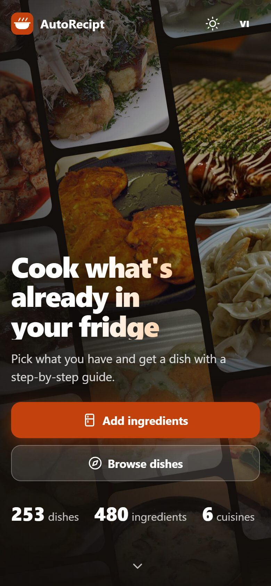
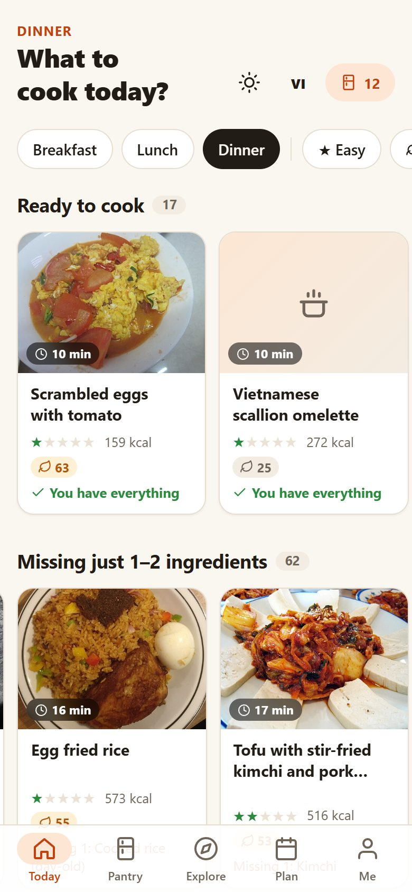
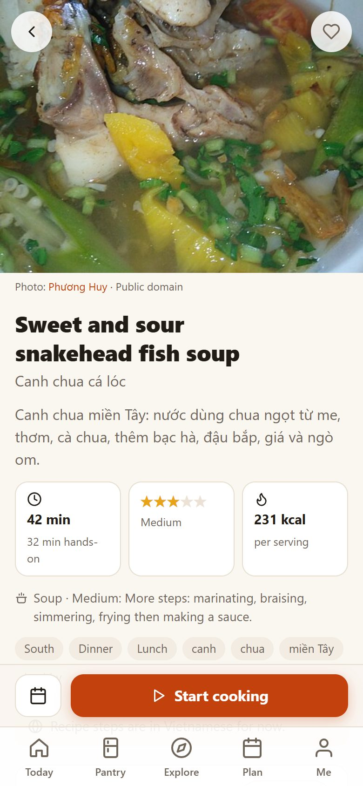
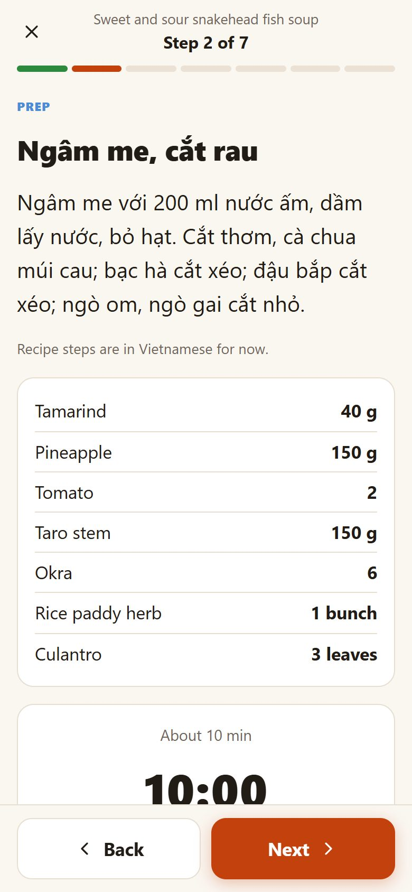
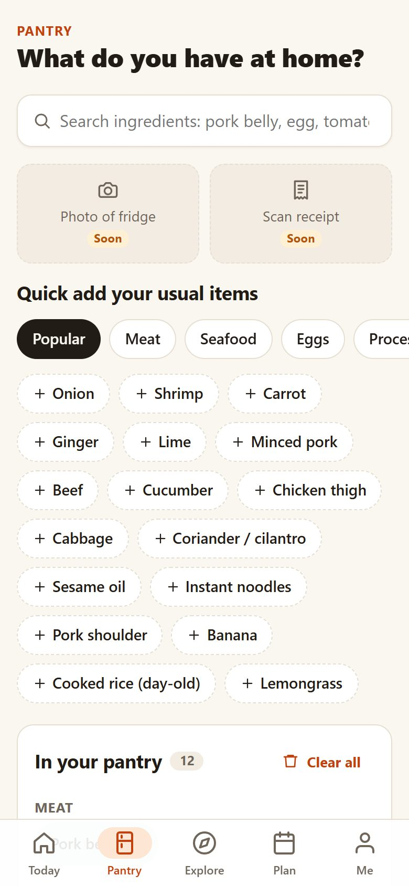
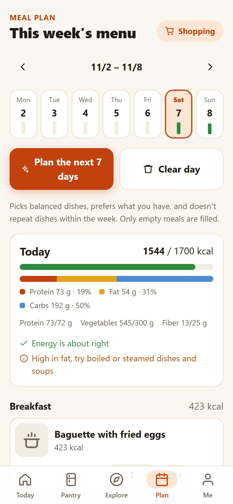
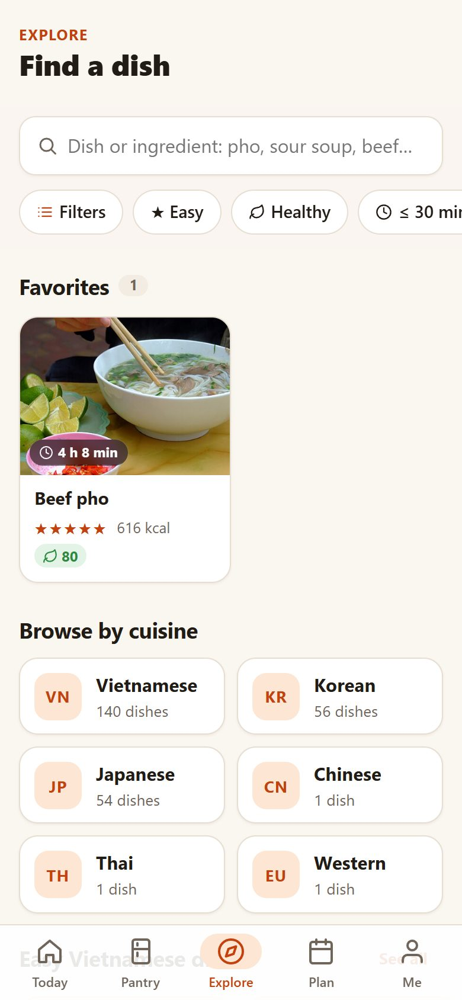
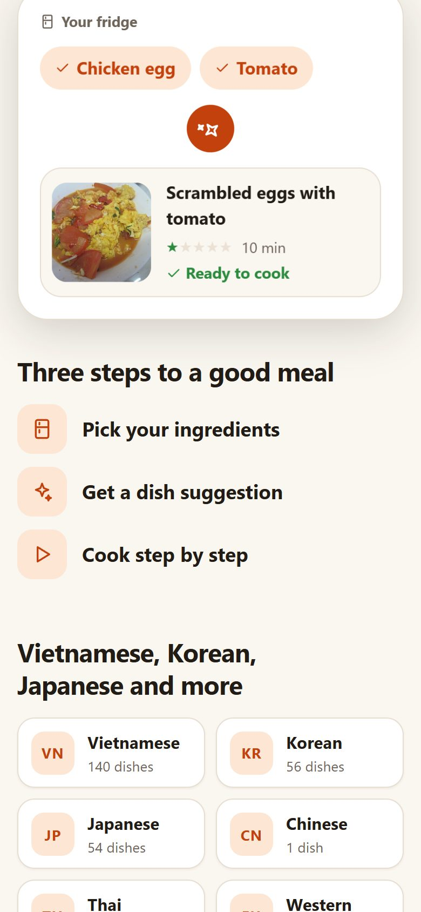
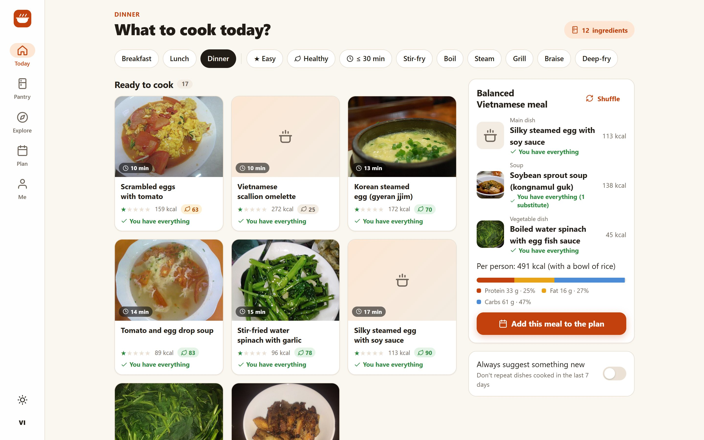
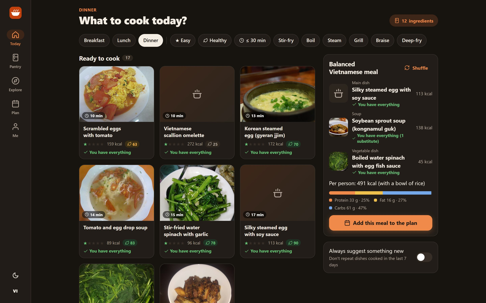

# AutoRecipt: Hôm nay ăn gì? (What should I cook today?)

**Tell it what's in your fridge, and it tells you what to cook.** AutoRecipt is a mobile-first
web app that suggests dishes you can make right now from the ingredients you already have,
walks you through each recipe step by step, plans a balanced week of meals and writes the
shopping list for you.

It has 253 Vietnamese, Korean and Japanese recipes and 480 ingredients. The interface is in
Vietnamese and English, with light and dark themes, and it installs on a phone like a native app
and works offline. Everything runs in the browser: there is no backend, no account, and personal
data never leaves the device.

<!-- Live demo: add your Vercel URL here, e.g. **[Live demo](https://your-app.vercel.app)** -->

<p align="center">
  
  
  
  
</p>

## The problem it solves

Every evening the same question comes up: *what do we eat tonight?* Recipe sites start from the
dish and assume you will go shopping. AutoRecipt starts from the other end: what is already in
the fridge, how much time you have, and whether you want something light. Then it ranks the dishes
that fit, easiest first.

## What you can do

| | |
|---|---|
| **Cook from your fridge** | Add what you have (search works without Vietnamese accents, or tap common items). Home shows *Ready to cook* and *Missing just 1–2 ingredients*, with substitutes for what you lack. |
| **Follow a recipe** | Scale servings and every amount follows. See which ingredients you have, which are missing and what can replace them. Calories and macros per serving. |
| **Cook step by step** | Cook mode shows one step per screen in large text, with only that step's ingredients. Step timers keep correct time even when the phone is locked and ring at the end. The screen stays on. Swipe to move between steps. |
| **Eat a balanced meal** | A suggested *mâm cơm* (the Vietnamese family meal of a main dish, a soup and a vegetable, with rice) with its total calories and macro split. |
| **Plan the week** | One tap fills 7 days with balanced meals that don't repeat, prefer what's in your fridge and fit a daily calorie target worked out from your body and activity level. The day view tracks protein, vegetables and fiber, and gives advice. |
| **Shop** | The shopping list adds up every planned dish, leaves out what you already have, and copies to the clipboard. |
| **Explore** | Search by dish or ingredient. Filter by cuisine, dish type, cooking method, protein, meal, difficulty (1–5 stars), "healthy" or "30 minutes or less". |
| **Keep it fresh** | An optional setting hides dishes you cooked in the last N days. |

<p align="center">
  
  
  
  
</p>

On a tablet or computer the bottom tab bar becomes a side rail and screens use the extra width:

<p align="center">
  
  
</p>

## How it works

```
recipt.json + data/*.json  ──►  db/build_db.py  ──►  autorecipt.db (SQLite, 1.7 MB)
  (recipes, ingredients,          validates,              │
   nutrition, lookups)            computes nutrition      ▼
                                  and health scores   app/  React + sql.js (WebAssembly)
        ▲                                                 runs the database in the browser
        │                                                 │
   admin/  local dashboard                                ├─► localStorage: pantry, plan,
   (edit, validate, publish)                              │   history, profile (on device only)
                                                          └─► service worker: works offline
```

**Data pipeline.** Recipes, ingredients and nutrition live as plain JSON so they are easy to
review in git. A Python build script (standard library only) validates everything, links each
recipe line to an ingredient, and works out per-serving calories, protein, fat, carbs, fiber and
vegetables from a nutrition table and unit weights. It gives each dish a 0–100 health score with
the reasons behind it (low fat, vegetable rich, deep fried…) and writes one SQLite file.

**The database runs in the browser.** The app downloads that file once and opens it with sql.js
(SQLite compiled to WebAssembly). Search, filtering and pantry matching are SQL and in-memory
lookups, so they are instant and keep working offline.

**Ranking.** For each dish the app counts how many key ingredients you have, counting
substitutes and ignoring basic seasonings everyone has. Dishes are sorted by that match, in 10%
steps so a much easier dish beats one that matches only slightly better, then by difficulty,
missing count, time and health score. Search is accent-insensitive with the same normalization
in Python and TypeScript.

**Meal planning.** Every dish has a role in a Vietnamese meal (main, soup, vegetable, one-dish
meal like phở). Breakfast, and lunch every other day, is a one-dish meal; the other meals are a
main dish, a soup and, when those are light on vegetables, a vegetable dish, with rice. Each meal gets a share of the
daily target, which comes from the Mifflin-St Jeor equation, activity level and goal. Dishes don't
repeat within the week while enough are left, and a seeded random makes "shuffle" repeatable.

**Offline and installable.** A service worker caches the app shell, the database and the
WebAssembly on the first visit, and recipe photos as you view them. The app installs to the home
screen on iPhone and Android. When a new database is deployed, open copies notice within a minute
and offer to reload.

**SEO and link previews.** The app uses real URLs (`/recipe/pho-bo`). At build time a Vite plugin
reads the database and writes a static page for every recipe and ingredient (529 pages) with its
own title, description, Open Graph image and schema.org `Recipe` data, plus `sitemap.xml` and
`robots.txt`. Search engines can index each recipe, and links shared in chat apps show the dish
photo even though those apps don't run JavaScript.

**Admin dashboard.** A small Python server plus a React UI for editing recipes, ingredients,
nutrition and lookups. Every save is applied to a copy, rebuilt and validated first. Only a
clean build replaces the data files (with a backup) and publishes the new database to the app.

## Tech stack

| Part | Built with |
|---|---|
| App | React 19, TypeScript, Vite, sql.js (SQLite/WebAssembly), i18next, hand-written CSS (no UI library) |
| Data | JSON sources, Python 3 build script (standard library), SQLite |
| Offline | Service worker, Web App Manifest, Screen Wake Lock, Web Audio (timer alarm) |
| Quality | Vitest + jsdom (54 tests that render screens against the real database), oxlint, TypeScript type checks |
| Hosting | Vercel (static); the `app/` folder deploys on its own |

## Numbers

- 253 recipes (140 Vietnamese, 56 Korean, 54 Japanese, a few Chinese, Thai and Western) and 480
  ingredients with nutrition per 100 g
- About 135 KB of JavaScript gzipped, plus a 1.7 MB database and 0.7 MB of WebAssembly, cached
  after the first visit
- No server and no tracking. Personal data stays in the browser and can be backed up to a JSON
  file.

## Run it locally

Needs Node 20+ (and Python 3.10+ only to rebuild the data).

```
cd app
npm install
npm run dev        # http://localhost:5173, also reachable from a phone on the same Wi-Fi
npm test
npm run build      # static site in app/dist/
```

After editing recipes in `recipt.json` or `data/`, run `python db/build_db.py` from the repo root;
the next `npm run dev` or `npm run build` picks up the new database.

Admin dashboard: `cd admin/ui && npm install && npm start`, then open http://127.0.0.1:8787.

Deploying to Vercel: set the project's Root Directory to `app`. See
[app/DEPLOY.md](app/DEPLOY.md) for the full checklist, caching, SEO and releases. The version and
commit of the running build are shown at the bottom of every screen.

## Project layout

| Folder | What it holds |
|---|---|
| `recipt.json`, `data/` | Source data: recipes, ingredients, nutrition, lookup tables |
| `db/` | `build_db.py` (JSON to SQLite), `fetch_images.py` (caches recipe photos), schema |
| `app/` | The web app; `app/scripts/seo.ts` is the build step for SEO pages |
| `admin/` | Local editing dashboard (Python server + React UI) |
| `docs/screenshots/` | Images used in this README |

More detail: [app/README.md](app/README.md), [db/README.md](db/README.md),
[admin/README.md](admin/README.md).

## Data and credits

Recipe text is written for this app and cross-checked against Bách hóa XANH, Điện máy XANH and
Wikipedia articles (linked from each recipe). Photos come from Wikimedia Commons under free
licenses, and each recipe shows its photo's author and license. Nutrition values are estimates for
home cooking, not medical advice. Recipe steps are in Vietnamese; dish and ingredient names and
the whole interface are also in English.
